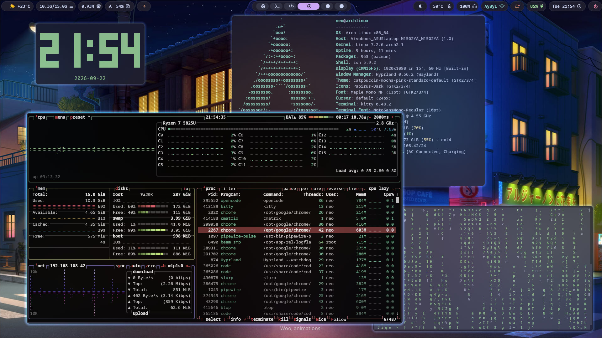

# Arch Hyprland Dotfiles

Entorno de desarrollo reproducible para Arch Linux: instalador bash modular y configs de Hyprland/Hyprlock/Hyprpaper/Hypridle/Waybar/Kitty/Wofi/SwayNC/SwayOSD, con extras opcionales.



## Índice

- [Requisitos previos](#requisitos-previos)
- [Instalación](#instalación)
- [Estructura](#estructura)
- [Módulos del instalador](#módulos-del-instalador)
- [Documentación](#documentación)
- [Extras opcionales](#extras-opcionales)
- [Contributing](#contributing)
- [Licencia](#licencia)

## Requisitos previos

- **Arch Linux** (el bootstrap lo verifica vía `/etc/os-release`).
- **Hyprland instalado** — el instalador configura sus herramientas (`hyprpaper`, `hypridle`, `hyprlock`, `hyprsunset`) y los portales (`xdg-desktop-portal-hyprland`), pero **no instala el compositor**.
- Un usuario normal con **`sudo`** (no se ejecuta como root).
- **Conexión a internet**.
- `git`, `curl` y `unzip` — el bootstrap los instala si faltan.

## Instalación

### Rápida

```bash
bash -c "$(curl -fsSL https://raw.githubusercontent.com/ayunierto/arch-dotfiles/main/bootstrap.sh)"
```

### Manual

```bash
git clone https://github.com/ayunierto/arch-dotfiles.git ~/.dotfiles
cd ~/.dotfiles
./install.sh
```

Es idempotente: los archivos existentes se respaldan como `<archivo>.bak.<epoch>` antes de reemplazarse por symlinks. Al terminar, abre una terminal nueva o ejecuta `exec zsh`.

## Estructura

```
.dotfiles/
├── bootstrap.sh      # clona el repo y lanza install.sh (solo Arch)
├── install.sh        # carga lib/ y ejecuta modules/ en orden
├── lib/              # helpers (pacman, AUR, symlinks, systemd, logs)
├── modules/          # pasos del instalador (10..90)
├── config/           # gtk, hypr, kitty, opencode, swaync, swayosd, waybar, wofi
├── bin/              # wifi-menu, wofi-emoji, screen-recorder, reload-waybar, reload-swaync
├── docs/             # guías adicionales
└── extras/           # extras opcionales (no los instala install.sh)
```

`~/.zshrc`, `~/.aliases`, `~/.exports`, `~/.gitconfig`, los temas de opencode (`~/.config/opencode/themes`) y `~/.config/{gtk-3.0,gtk-4.0,hypr,kitty,swaync,swayosd,waybar,wofi}` son symlinks a este repo. Edita aquí, no las copias enlazadas.

## Módulos del instalador

Se ejecutan al hacer `source`, en orden numérico:

- `10-system.sh` — paquetes base vía `pacman`
- `20-aur.sh` — paquetes AUR vía `yay`
- `30-zsh.sh` — Oh My Zsh + plugins
- `40-node.sh` — NVM + Node LTS
- `45-gtk.sh` — tema GTK y cursor vía gsettings (libadwaita/GTK4)
- `50-dotfiles.sh` — symlinks de configs
- `70-docker.sh` — Docker + grupo
- `90-finish.sh` — ajustes finales

## Documentación

Explicaciones detalladas en páginas aparte:

- **Atajos de teclado** — tabla completa de atajos de Hyprland, definidos en `config/hypr/modules/keybinds.lua`. Ver [`docs/KEYBINDS.md`](docs/KEYBINDS.md).
- **Sistema de temas** — cómo se definen los colores por capas (waybar/swaync/swayosd, apps GTK, opencode, kitty y hypr). Ver [`docs/THEMING.md`](docs/THEMING.md).
- **Waybar** — barra activa, fuentes y módulos custom (DeepSeek, hyprsunset). Ver [`config/waybar/README.md`](config/waybar/README.md).
- **Utilidades** — menú Wi-Fi, selector de emojis y grabador de pantalla. Ver [`docs/UTILITIES.md`](docs/UTILITIES.md).
- **Android SDK CLI** — Android SDK Command Line Tools para Expo / React Native. Ver [`docs/COMMAND_LINE_TOOLS.md`](docs/COMMAND_LINE_TOOLS.md).
- **Thermal Guard** — ajuste automático de potencia en AMD Ryzen (extra opcional). Ver [`extras/thermal-guard/README.md`](extras/thermal-guard/README.md).

## Extras opcionales

No forman parte de `install.sh`; se instalan aparte porque son específicos de un perfil concreto:

- **Thermal Guard** (`extras/thermal-guard/`): ajuste automático de potencia en AMD Ryzen por temperatura. Instrucciones en `extras/thermal-guard/README.md`.

## Contributing

No dudes en abrir incidencias y solicitudes de fusión con las correcciones.

## Licencia

MIT, ver `LICENSE`.
